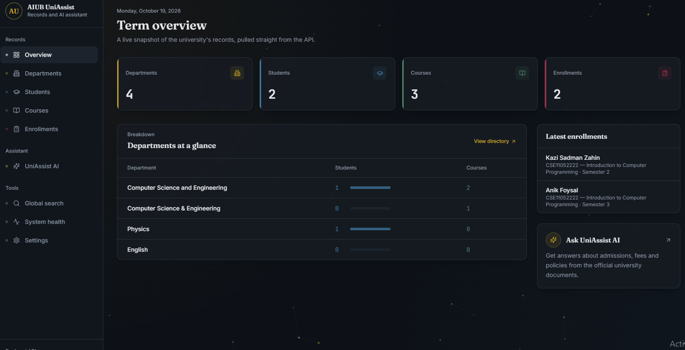
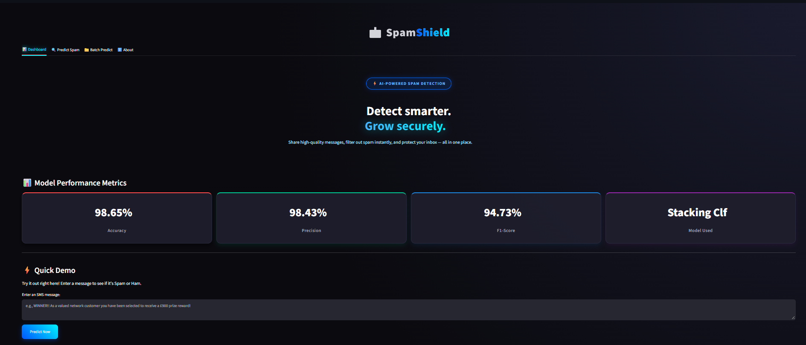
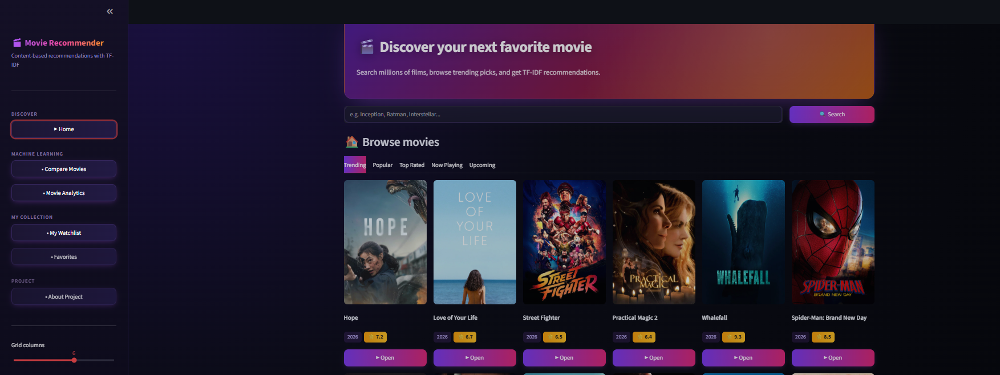
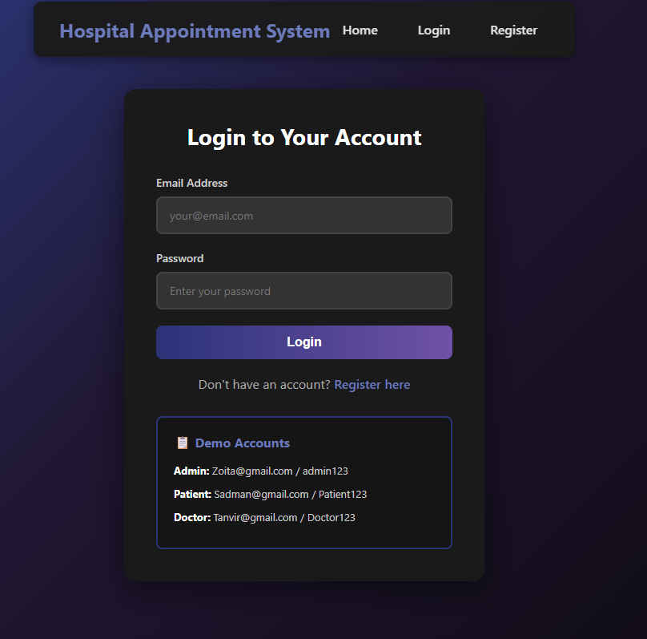
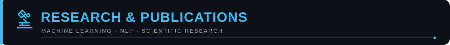

<!-- ====================================================== -->
<!-- KAZI SADMAN ZAHIN | GITHUB PROFILE README              -->
<!-- ====================================================== -->

 

  

---

<!-- About Me -->

  

I am a Computer Science and Engineering undergraduate at **American International University-Bangladesh (AIUB)**, interested in building practical machine learning applications, AI-powered systems, and reliable backend services.

- 🎓 B.Sc. in Computer Science and Engineering at AIUB
- 🤖 Interested in Machine Learning, NLP, RAG, and Explainable AI
- ⚙️ Building backend applications and REST APIs with Python, FastAPI, and Django
- 🧠 Exploring multilingual NLP and cross-lingual fake news detection
- 🔬 Research experience in drug solubility classification and SMS spam detection
- 💻 Practicing competitive programming and problem-solving
- 🌱 Continuously learning through research, experimentation, and project development

**Current focus:** Machine Learning, NLP, Retrieval-Augmented Generation (RAG), and Backend Engineering.

---

<!-- Tech Stack -->

  

### Programming Languages

  

### Machine Learning & AI

  
  
  
  
  
  

### Backend & APIs

  
  
  
  

### Databases & Vector Search

  
  

### Frontend & Tools

  

---

<!-- Featured Projects -->

  

### 1. AIUB UniAssist

**Hybrid RAG-Powered University Information and Course Management System**

  

An AI-powered university information system combining hybrid retrieval with database-backed academic management.

**Key Features**

- REST APIs for department, student, course, and enrollment management.
- Hybrid retrieval using BGE-M3 embeddings and BM25.
- Reciprocal Rank Fusion (RRF) for combining retrieval results.
- Qdrant vector search and an AIUB-specific knowledge base.
- LLM integration using LangChain and OpenRouter.

**Tech Stack**

**Links:** [🌐 Live Demo](https://aiub-uni-assist.vercel.app/) · [📂 GitHub Repository](https://github.com/Kazi-Sadman/AIUB-UniAssist-A-Hybrid-RAG-Powered-University-Information-and-Course-Management-System)

---

### 2. SMS Spam Classifier

**Machine Learning-Based SMS Classification**

  

An interactive application that classifies SMS messages as spam or legitimate messages using machine learning and natural language processing.

**Key Features**

- Text preprocessing and TF-IDF feature extraction.
- Comparison of machine learning and ensemble approaches.
- Single-message prediction and batch CSV classification.
- Model evaluation and cross-dataset validation.

**Tech Stack**

**Links:** [🌐 Live Demo](https://smsspamclassifier-2ozcpwt4scvdrtrnvdytug.streamlit.app/) · [📂 GitHub Repository](https://github.com/Kazi-Sadman/sms_spam_classifier)

---

### 3. Movie Recommendation System

**Content-Based Movie Recommendation**

  

A movie recommendation application that uses textual features and similarity scoring to recommend related movies.

**Key Features**

- TF-IDF feature extraction.
- Cosine similarity-based recommendation ranking.
- TMDB API integration.
- FastAPI backend with a deployed application interface.

**Tech Stack**

**Links:** [🌐 Live Demo](https://movie-recommendation-app-sfxg.onrender.com/) · [📘 API Documentation](https://movie-recommendation-api-7910.onrender.com/docs) · [📂 GitHub Repository](https://github.com/Kazi-Sadman/Movie-Recommendation-System)

---

### 4. Hospital Appointment Booking System

**Web-Based Hospital Management**

  

A web-based hospital management system supporting appointment workflows and separate patient, doctor, and administrator roles.

**Key Features**

- Patient, doctor, and administrator modules.
- Authentication and role-based access control.
- Appointment management and AJAX-based interactions.
- Password hashing, prepared statements, and input validation.

**Tech Stack**

**Links:** [🌐 Live Demo](https://hospitalmanagementsadman.infy.click) · [📂 GitHub Repository](https://github.com/Kazi-Sadman/HospitalAppointmentSystem)

---

  

### 1. Drug Solubility Classification

**Scaffold-Aware Drug Solubility Classification: Quantifying Generalization Gaps in Machine Learning Models with SMOTE and Extended Molecular Fingerprints on AqSolDB**

Presented at **IEEE BECITHCON 2026**; accepted for publication.

Research focus: Molecular fingerprints, class imbalance, SMOTE, scaffold-aware evaluation, and model generalization.

### 2. SMS Spam Detection

**An Ensemble Machine Learning Approach for SMS Spam Detection: Comparative Evaluation and Cross-Dataset Validation**

Under review at the 29th International Conference on Computer and Information Technology (ICCIT 2026), IEEE Bangladesh Section.

Research focus: Ensemble machine learning, text classification, precision, false-positive reduction, and cross-dataset evaluation.

---

<!-- Current Research Interest -->

  

**An Explainable Language-Aware Cross-Lingual Framework for Bangla-English Fake News Detection Using Multilingual Transformers and Classical Machine Learning**

My research interests include:

- Bangla-English cross-lingual NLP
- Multilingual transformer models
- Classical machine learning baselines
- Explainable AI (XAI)
- Robust evaluation and cross-dataset generalization

---

  

| Platform        | Achievement                                      |
| --------------- | ------------------------------------------------ |
| CodeChef        | 2-Star · Maximum Rating: 1403                    |
| LeetCode        | Rating: 1483                                     |
| ICPC            | Regional participant twice                       |
| Problem Solving | 1,000+ problems solved across multiple platforms |

 

---

---

<!-- GitHub Statistics -->

  

&nbsp;&nbsp;

 

<!-- GitHub Contribution Activity -->

  

 

<!-- GitHub Contribution Activity -->

---

---

<!-- GitHub Contribution Streak -->

  

## 

<!-- Connect With Me -->

  

  

**Open to learning, research collaboration, and opportunities in Machine Learning and Backend Engineering.**

---

  
<i>Build with curiosity. Validate with evidence. Improve with every iteration.</i>

  

